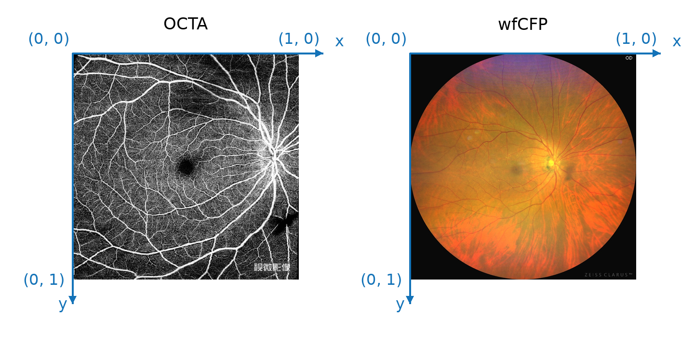
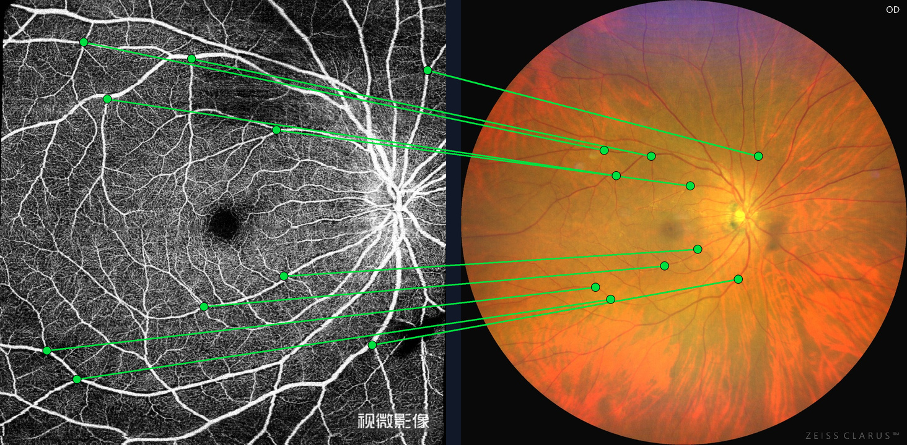
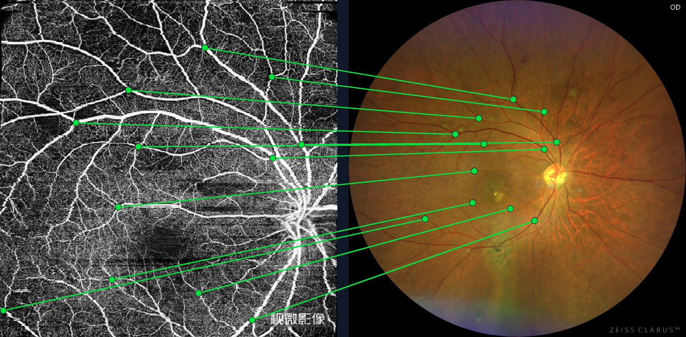
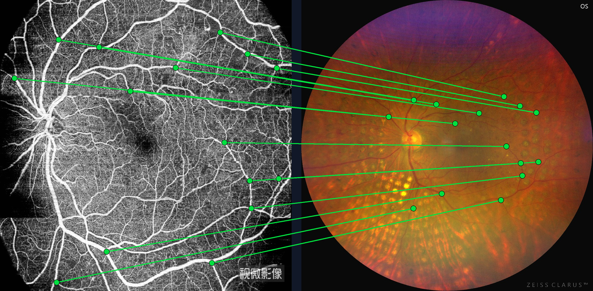
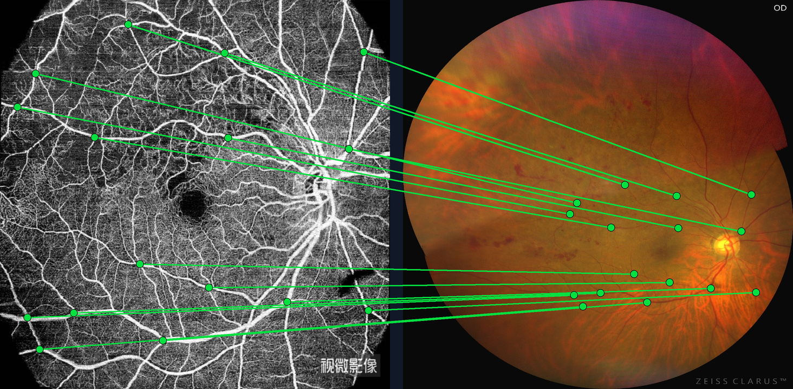
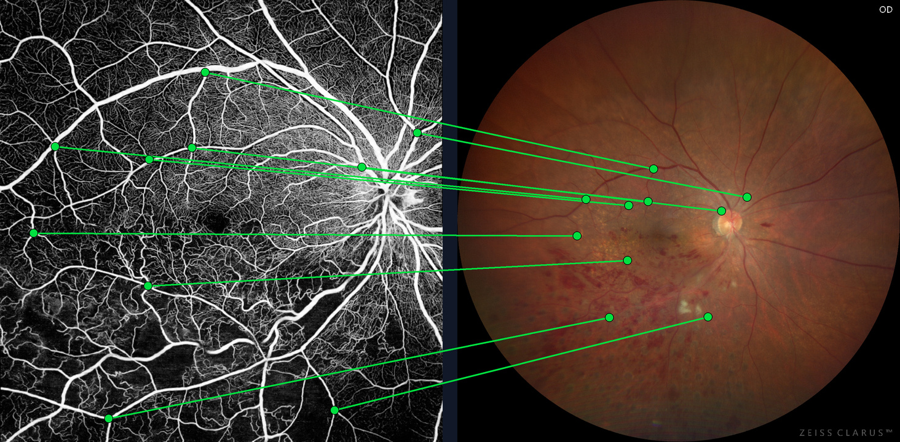
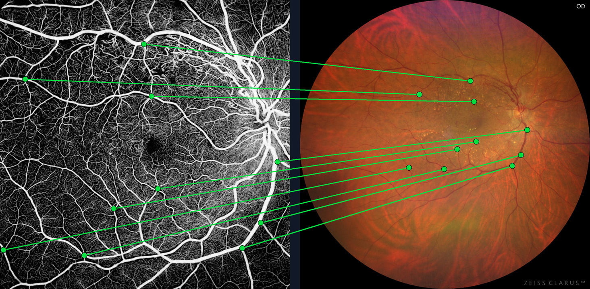
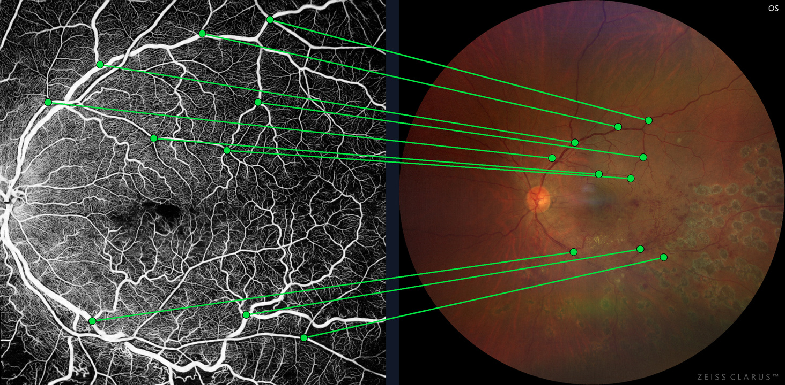
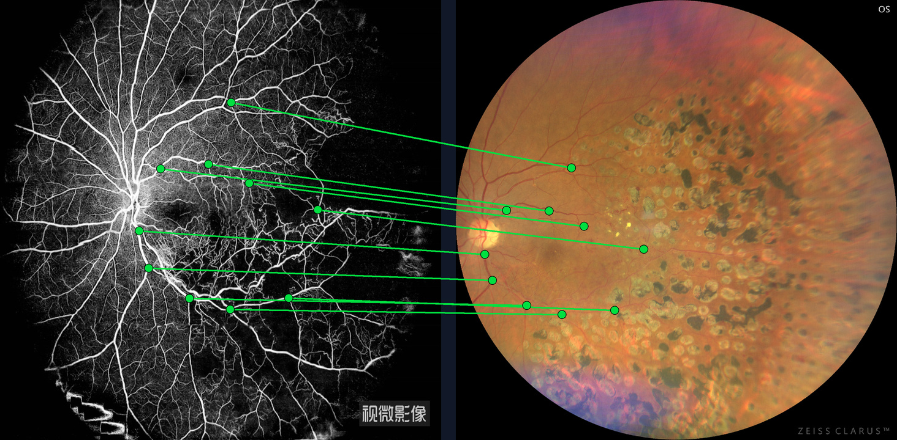

# OCTA-60

OCTA-60 is a fundus image dataset for evaluating cross-modal registration between optical coherence tomography angiography (OCTA) and wide-field color fundus photography (wfCFP) under large field-of-view (FoV) disparity. See our [MMM 2026 paper](https://link.springer.com/chapter/10.1007/978-981-95-6950-2_23) for details.

## Highlights

- **60 OCTA–wfCFP image pairs**, comprising 120 PNG images.
- **653 manually annotated point correspondences**, with 10–16 correspondences per image pair (10.88 on average).
- **Large FoV disparity** between OCTA (FoV ~ 40°) and wfCFP (FoV ~ 90°) images, presenting challenges in scale, coverage, and cross-modal appearance.
- **Registration benchmark** for evaluating cross-modal fundus image registration using manually annotated correspondences.

## Dataset Organization

```text
ReleaseVersion/
├── Images/
│   ├── 001_OCTA.png
│   ├── 001_wfCFP.png
│   ├── ...
│   ├── 060_OCTA.png
│   └── 060_wfCFP.png
└── GroundTruth/
    ├── 001.txt
    ├── ...
    └── 060.txt
```

Each sample consists of two images and one annotation file sharing the same pair ID.

Image dimensions in this release:

| Modality | Width × height (pixels) | Images |
| :--- | :--- | ---: |
| OCTA | 1000 × 1000 | 60 |
| wfCFP | 1000 × 1000 | 60 |

### Annotation Format and Coordinates

Each `GroundTruth/{ID}.txt` file contains whitespace-separated floating-point values. Each row records one correspondence in the following order:

```text
x_OCTA  y_OCTA  x_wfCFP  y_wfCFP
```

The coordinate system of each image has its origin at the top-left corner, with x increasing to the right and y increasing downward, as illustrated below. The annotation files store normalized relative coordinates in [0, 1].



## Visualization Examples

Each example shows OCTA on the left and wfCFP on the right. Lines connect the corresponding points recorded in each annotation row.

<table>
  <tr>
    <td><a href="Img/001_matches.jpg"></a></td>
    <td><a href="Img/009_matches.jpg"></a></td>
  </tr>
  <tr>
    <td><a href="Img/017_matches.jpg"></a></td>
    <td><a href="Img/021_matches.jpg"></a></td>
  </tr>
  <tr>
    <td><a href="Img/036_matches.jpg"></a></td>
    <td><a href="Img/045_matches.jpg"></a></td>
  </tr>
  <tr>
    <td><a href="Img/054_matches.jpg"></a></td>
    <td><a href="Img/060_matches.jpg"></a></td>
  </tr>
</table>

## Dataset Access

Data is freely available upon request. Please submit your request via [Google Form](https://forms.gle/sXWc7bkPbewQMtfC8).

## Citation

If you use OCTA-60 in your research, please cite our paper:

```bibtex
@inproceedings{li2026crossmodal,
  title={Cross-Modal Fundus Image Registration Under Large FoV Disparity},
  author={Li, Hongyang and Tao, Junyi and Wei, Qijie and Yang, Ningzhi and Wang, Meng and Yu, Weihong and Li, Xirong},
  booktitle={MultiMedia Modeling},
  pages={321--334},
  year={2026},
  organization={Springer}
}
```
