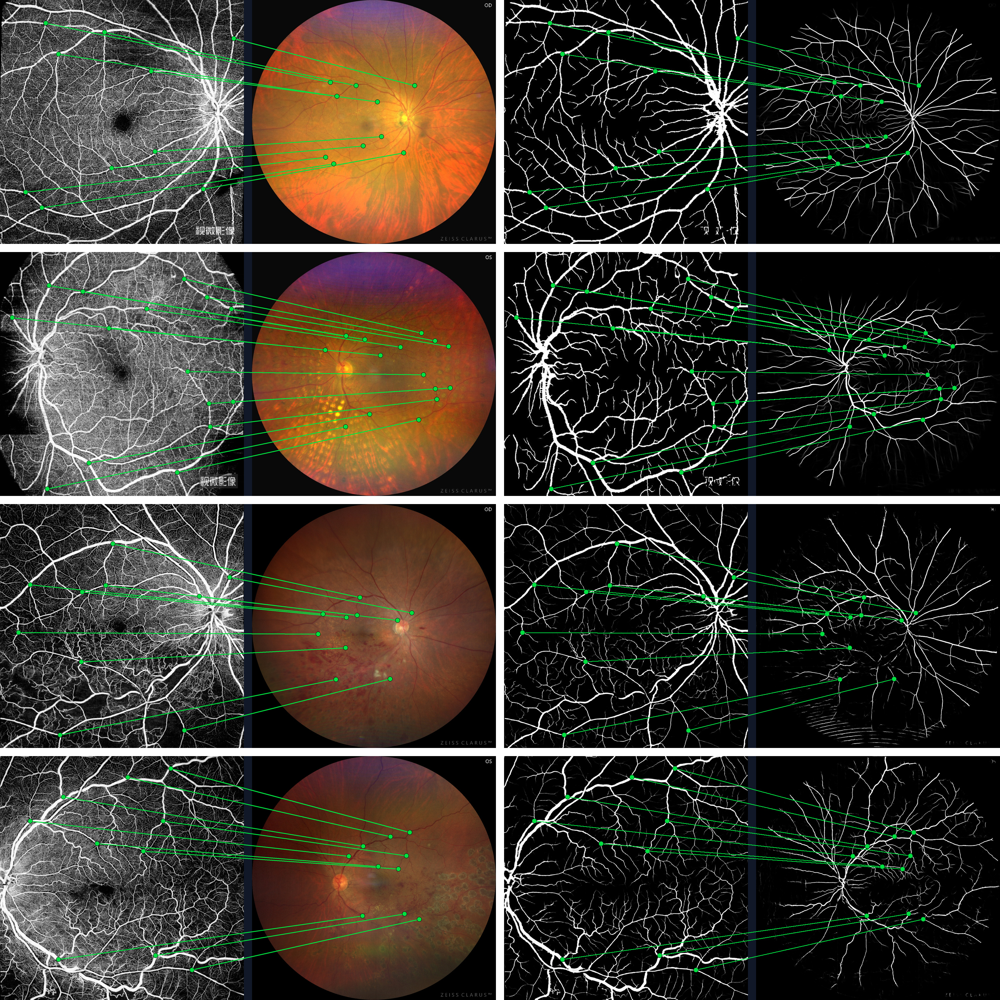
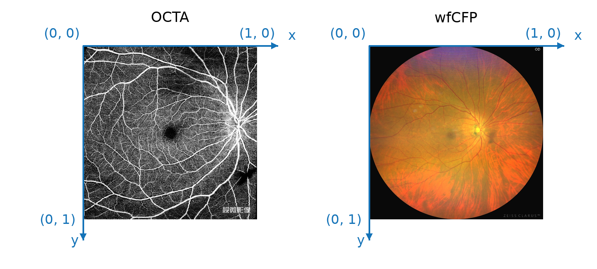

# OCTA60

OCTA60 is a research dataset jointly developed by RUC and PUMCH, dedicated to evaluate [cross-modal fundus image registration](https://arxiv.org/abs/2512.12657) algorithms in the presence of large field-of-view (FoV) disparity between the source (OCTA) and target (wide-field CFP, wfCFP) images. The dataset contains 60 pairs of OCTA and wfCFP images. Each pair is associated with 10 to 16 manually annotated point correspondences that can be used to compute OCTA-to-CFP registration errors. 



## Update

+ [2026-10-28] First release of OCTA60 (version `mmm26`)

## Data

The dataset is freely available upon request. Please submit your request via [Google Form](https://forms.gle/sXWc7bkPbewQMtfC8). The request review may take one week or so.

### Dataset Organization

Image IDs range from `001` to `060`. The OCTA, wfCFP images, their vessel maps (extracted by the [DCP](https://github.com/ruc-aimc-lab/dcp) algorithm) and point annotations are uniquely accessed via the image IDs, see below.

```text
OCTA60/
├── Annotations/
│   └── mmm26/
│       ├── 001.txt
│       └── ...
├── ImageSets/
│   └── OCTA60.txt
├── ImageData/
│   ├── OCTA/
│   │   ├── 001.png
│   │   └── ...
│   └── wfCFP/
│       ├── 001.png
│       └── ...
├── VesselData/
    ├── OCTA/
    │   ├── 001.png
    │   └── ...
    └── wfCFP/
        ├── 001.png
        └── ...
```


### Annotations

Each text file in the `Annotations` folder records a list of manually labeled correspondence points. The current version is `mmm26`, as used in our [CARe](https://arxiv.org/abs/2512.12657) method published in MMM'26.

```text
# x_OCTA  y_OCTA  x_wfCFP  y_wfCFP
0.283715 0.196842 0.402638 0.368917
0.617493 0.428156 0.541872 0.472305
0.394268 0.753921 0.448516 0.609734
...
```




## Evaluation

We provide [eval.py](eval.py) to evaluate results generated by a specific image registration algorithm on OCTA60. Given the results in the form of a JSON file, see [CARe.json](CARe.json), simply run 
```bash
python eval.py CARe.json
```
If everything is in place, you will see
```text
Failed rate: 0.00
Inaccurate rate: 0.05
Acceptable rate: 0.95
AUC@25: 0.758
```
Note that the pixel-wise thresholds for determining image registration errors are image-size dependent. With the thresholds fixed, smaller input yields "better" performance. To be in line with the widely used [FIRE](https://www.aivojournal.com/index.php/AIVO/article/view/42) evaluation protocol, we use an input size of [2912*2912](https://github.com/ruc-aimc-lab/OCTA60/blob/main/eval.py#L13), an [MEE threshold](https://github.com/ruc-aimc-lab/OCTA60/blob/main/eval.py#L10) of 20 pixels, and an [MAE threshold](https://github.com/ruc-aimc-lab/OCTA60/blob/main/eval.py#L11) of 50 pixels.

### Preparing your JSON file

Per test OCTA-wfCFP pair, your image registration algorithm is supposed to project all the annotated points in the OCTA image into the wfCFP  coordinate system. As such, the resultant JSON file is to store the new coordinates of the OCTA points (*normalized to* [0,1]) as follows:
```json
{
  "001": [
    [0.347883, 0.394041],
    [0.428049, 0.350214],
    [0.62342, 0.627309],
    [0.516026, 0.417407],
    [0.455447, 0.596122],
    [0.666075, 0.350182],
    [0.338318, 0.67197],
    [0.531706, 0.562973],
    [0.307842, 0.644995],
    [0.321568, 0.338461]
  ],
  "002": [],
  ...
}
```
The points are expected to appear in the same order as in the annotation files. In case of a failed registration, please use an empty list `[]`. As for a missing correspondence, also use `[]` as a placeholder. Please use the provided [format checker](check_format.py) to ensure your JSON file is valid:
```bash
python check_format.py yours.json
```
### Leaderboard

The state-of-the-art on OCTA60:

| Algorithm | AUC@25 |
|-----------|-------:|
| [CARe](https://arxiv.org/abs/2512.12657)      |  0.758 |
| [MINIMA](https://ieeexplore.ieee.org/abstract/document/11094727)         |  0.731 |
| [MatchAnything](https://arxiv.org/abs/2501.07556)         |  0.703 |


## Citation


```bibtex
@inproceedings{li2026cross,
  title={Cross-Modal Fundus Image Registration Under Large {FoV} Disparity},
  author={Li, Hongyang and Tao, Junyi and Wei, Qijie and Yang, Ningzhi and Wang, Meng and Yu, Weihong and Li, Xirong},
  booktitle={International Conference on Multimedia Modeling},
  pages={321--334},
  year={2026},
}
```
